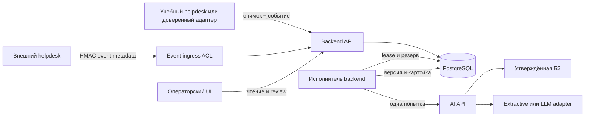

# LAB03: реализация событийного MVP

Основание: Product UC-01–04, ADR-003, контракт AI событий и EVT-01–14 Quality из LAB02.
Это реализация учебного MVP, не изменение продуктовых требований и не новая оценка модели.

## Соответствие LAB02

| Проект LAB02 | Работающий LAB03 |
|---|---|
| Событийный ingress ACL | backend/ingress.py, отдельный процесс, проверка HMAC до передачи |
| Владелец очереди backend | backend/events.py, транзакции PostgreSQL, SKIP LOCKED, lease/fencing |
| Один running и один queued на тикет | Частичные unique-индексы и глобальная транзакционная блокировка |
| Снимок из разрешённого helpdesk | /internal/snapshots с отдельным service token, immutable версия |
| Только metadata в webhook | /ingress/events, запрет лишних полей, Pydantic и лимит 64 KiB |
| AI API | backend/ai_service.py, service token, один вызов на резерв |
| Карточка и audit | analysis_proposal и operator_review сохранены, версия проверяется атомарно |
| Общие квоты | PostgreSQL advisory lock + журнал model_attempt, без сброса после рестарта |
| Трассировка | event_trace в PostgreSQL, /api/traces и UI; существующий SDK Langfuse при настройке |

Прежний LAB03 хранил UUID как TEXT и карточки JSON. Миграция 003 сохраняет этот
формат и все данные вместо удаления БД ради точного совпадения DDL LAB02.
ticket_snapshot соответствует текущей версии ticket_ref из проекта; analysis_event,
analysis_job и model_attempt сохраняют его ключевые ограничения. Исторические
карточки имеют input_version=NULL: версия для них не выдумывается. После появления
новой версии по этому тикету старую карточку подтверждать нельзя. SQL-триггеры
также запрещают устаревший review; предложения неизменяемы.

Глобальный advisory lock 310012 координирует admission/claim/finish/review. Это
сознательное ограничение производительности MVP. Порядок блокировок общий;
модель вызывается после commit и освобождения блокировки. Новая версия может
прийти во время inference, но старый результат останется только в истории.

Попытка и консервативный резерв input UTF-8 bytes + 65536 записываются до сети.
65536 покрывает текущую фиксированную схему, БЗ, служебный промпт и max_tokens=1000;
это верхняя учебная оценка, не реальный биллинг. Расширение БЗ/промпта требует
пересмотра резерва. Лимит RPM включает начатые и неизвестные попытки. TOKEN_BUDGET
считает все резервы за жизнь БД. При исчерпании задача ждёт до общего deadline,
затем переходит в manual_review. Увеличение бюджета требует явной настройки.

## Границы развёртывания

Compose разделяет API, worker, AI и ingress. Knowledge/store/provider adapters
из C4 остаются модулями существующих сервисов, не самостоятельными заглушками.
Учебный helpdesk simulator не претендует на реальную интеграцию с чужой системой.
Исходящая отправка не реализована, review сообщает external_action_performed=false.

Для одного бесплатного Render web service те же очередь, транзакции и лимиты
работают с исполнителем в фоне backend и AI-модулем в том же процессе. При
START_WORKER=true (значение по умолчанию) отдельный платный worker не нужен.
При AI_BASE_URL заданной worker использует HTTP AI; без неё вызывает тот же
baseline локально с max_attempts=1. Топология Compose и Render явно различается,
состояния и протокол версий совпадают. Neon нужен для сохранения данных.

## Передача Quality и AI

Транспортные проверки в tests/test_events.py не являются модельными evals.
EVT-01–14 покрыты техническими проверками очереди; UC-режимы и provenance
используют существующий baseline/контракт и прежние review-регрессии.
Нужен отдельный review Quality новой реализации и авторизованный публичный
сквозной прогон и проверка сохранности после рестарта. Подтверждение команды здесь не выдумывается.
