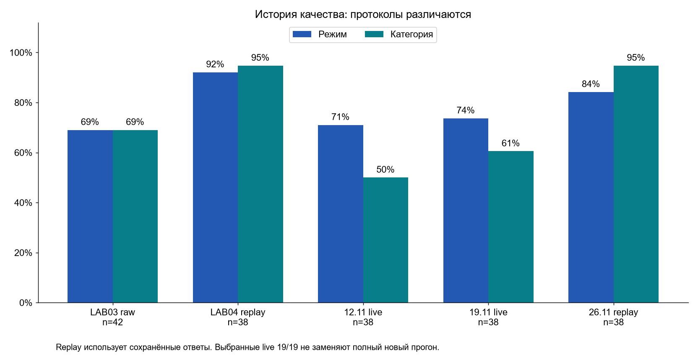

# LAB06: почему результатам можно доверять

Подготовка Quality & Safety на 26.11.2026. Для подготовленного сценария выбран тег `lab6-quality-demo-2026-11-26-r1`.
Дата Demo Day пока не назначена. Это готовый блок рассказа и подготовительные проверки, а не
заявление о полностью выполненной финальной регрессии за сутки до показа.

## Факты для выступления

1. Полный replay 38 разных входов на исправленном коде: режим **32/38**,
   категория **36/38**, Macro-F1 категории **0,9321**, схема и точные цитаты **38/38**.
2. На тех же сохранённых генерациях режим вырос **28→32/38**, категория **23→36/38**.
   Эталоны не менялись. Это эффект обработки ответов, не новая генерация моделей.
3. Отдельная выбранная живая серия AI от 20.11: **19/19** по режиму и категории.
   Она не заменяет полный новый независимый live-набор.
4. Выбранный демо-путь повторён **18/18**, проверки атак — **16/16**,
   отказы провайдеров — **5/5**; четыре регрессии найденного дефекта 2FA повторены.
   Реальные API, очередь и SQLite; ответы провайдеров сохранённые/управляемые.
5. North Star остаётся **n=0**, режим полного replay **84,2% ниже цели 90%**.
   Структура и точная цитата не доказывают смысловую истинность всех утверждений.

[Числа графика](metrics.json). Протоколы графика различаются: raw/live — новые
ответы, replay — сохранённые ответы и работа кода. Из этого нельзя выводить
доказанное превосходство каскада на независимом потоке.

## Подтверждения

- [Полный пересчёт LAB05](https://github.com/vstu-sii/razbor-obrascheniy-v-podderzhku-rh5e/blob/8f6d9bc0b9ec13ddf6ce6f147ab177258564a51c/tests/evals/evidence/lab5-current-20261126/report.json).
- [Отчёт качества LAB05](https://github.com/vstu-sii/razbor-obrascheniy-v-podderzhku-rh5e/blob/8f6d9bc0b9ec13ddf6ce6f147ab177258564a51c/docs/quality/final-quality-report.md).
- [Технический suite: шесть групп, 182 теста приложения](https://github.com/vstu-sii/razbor-obrascheniy-v-podderzhku-rh5e/blob/8f6d9bc0b9ec13ddf6ce6f147ab177258564a51c/tests/evals/evidence/lab5-current-20261126/technical-summary.json).
- [Проверки демо](../../tests/evals/evidence/lab6-preparation/summary.json).
- [Прогон атак](redteam-check.md).

Новый полный live после последних правок, независимая смысловая оценка,
человеческий North Star и замер операторского времени не выполнены. Видео и
командная репетиция не подменяются автоматическими тестами. Финальный результат
на замороженном демо-теге нужно приложить после выбора даты и версии.

Для выступления: «Мы повторили выбранные кейсы через приложение, проверили
инъекции и отказы, сохранили результаты. Классификация улучшилась, но режим
ещё ниже цели; полезность оператору предстоит измерить людьми».

## Включение в презентацию

[Презентация PDF](presentation.pdf): слайд2 — как работает AI; слайд3 —
измерения качества; слайд4 — безопасность и ограничения. Это совместно показанные
блоки презентации, не только отдельный архитектурный документ.
[Порядок и текст слайдов](presentation.md).
