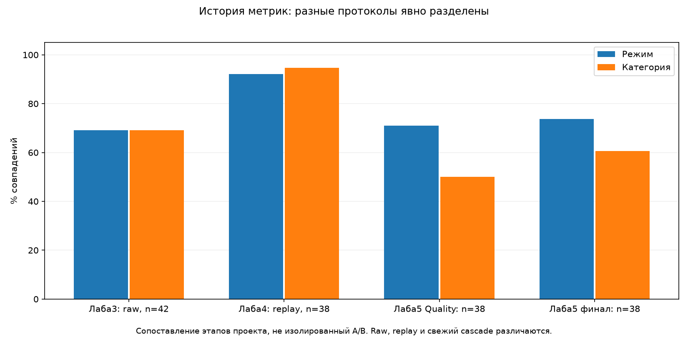
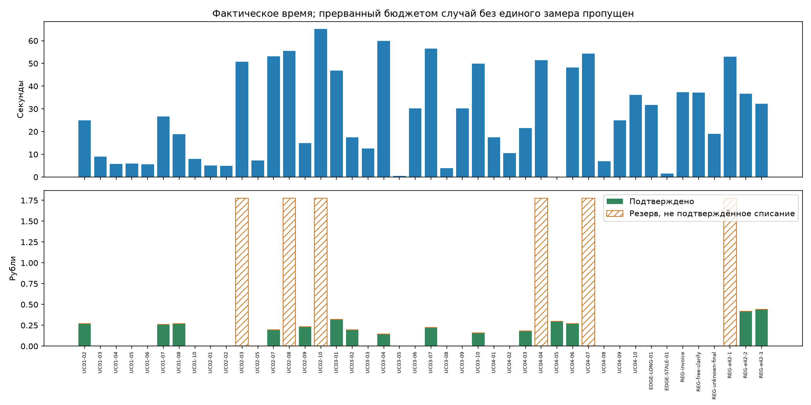
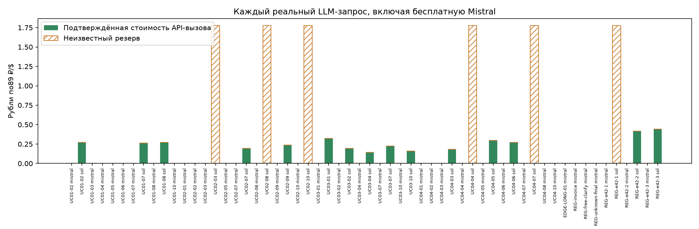

# Финальные метрики AI · LAB05

Дата: 19.11.2026. Runtime `lab5-ai-engineer-testing-2026-11-19`, commit `cd523e07edbeea7daf25d99902fcf97576f605a0`.
[Хеши и протокол](../../ml/experiments/lab5/evidence/final/config.json).
Полный фиксированный набор обработан: **44/44** входа. Входы, промпты и модельный
код во время серии не менялись, платных повторов не было, cache выключен.

## Данные и метод

38 известных обращений Quality Q015 (49 исходных записей сгруппированы в 38
уникальных входов) проверены с неизменёнными вопросами, историей, KBv1/v2 и
эталонами. Ещё 6 ранее одобренных регрессий KB support-20261119 считаются отдельно.
Это development-набор, не независимая выборка. Эталоны не передаются моделям.
Старая taxonomy и политика clarify/escalate местами отличаются от нового каскада;
несовпадения сохранены, не исправлены в gold после генераций.

После 31 входа первоначальный предел 10 ₽ исчерпался из-за неизвестных резервов.
Участник отдельно разрешил 20 ₽ на весь финальный прогон. Продолжены только
оставшиеся входы; уже полученная первая ступень остановленного случая не
генерировалась повторно. Обе фазы сохранены в evidence/final/phases/.
У одного прерванного входа нет единой непрерывной latency: она исключена,
вместо сложения разрозненных интервалов в вымышленный замер.

| Метрика | Quality38 | Регрессии 6 |
|---|---:|---:|
| Режим | 28/38 (73.7%) | 4/6 (66.7%) |
| Категория | 23/38 (60.5%) | 5/6 (83.3%) |
| Category Macro-F1 | 0.6393 | 0.6296 |
| Валидная итоговая схема | 38/38 (100.0%) | 6/6 (100.0%) |
| Точные итоговые ссылки/цитаты | 38/38 (100.0%) | 6/6 (100.0%) |
| Ложный answer среди non-answer | 0/28 (0.0%) | 0/4 (0.0%) |
| Автоматический исход | 16/38 (42.1%) | 4/6 (66.7%) |
| Схема card raw Mistral, без assessment | 31/31 (100.0%) | 6/6 (100.0%) |
| Recall@3 BM25 | 10/11 (90.9%) | 6/6 (100.0%) |
| Recall всех BM25 hits | 10/11 (90.9%) | 6/6 (100.0%) |

Валидность card raw Mistral проверена среди полученных карточек и не включает
assessment: ошибки этого внутреннего блока перечислены ниже. Итоговая схема
и проверка ссылок учитывают безопасные fallback; отсутствие evidence также
проходит проверку происхождения и не означает найденный ответ.
Структурный fallback не повышает raw-качество модели. Валидная цитата не
доказывает, что она поддерживает каждое утверждение. False-answer по gold —
совпадение режима, не полная семантическая разметка всех атомарных фактов.
Macro-F1 усредняется по объединению реально представленных gold/pred классов
в соответствующей группе; классы и TP/FP/FN записаны в metrics.json.

## Критерии успеха

Пороги взяты из исходных критериев Quality/PRD, не ослаблены после прогона.

| Критерий | Факт | Цель | Итог |
|---|---:|---:|---|
| Режим Q015 | 73.7% | ≥90.0% | Не достигнут |
| Категория Q015 | 60.5% | ≥90.0% | Не достигнут |
| Macro-F1 Q015 | 63.9% | ≥85.0% | Не достигнут |
| Recall@3 | 90.9% | ≥85.0% | Достигнут на этой выборке |
| Схема | 100.0% | ≥99.0% | Достигнут на этой выборке |

Наблюдаемые доли ошибок не доказывают промышленную границу≤2%; выборка мала.
North Star≥85% удобных карточек требует отдельного пользовательского протокола.
Историческая ручная оценка 6/6 относится к прежним показанным карточкам, а не
к 44 новым генерациям. Свежая независимая семантическая оценка не выдумывается.

## Динамика лабораторных

| Этап | n и протокол | Режим | Категория |
|---|---|---:|---:|
| LAB03,15.10 |42, первый raw Mistral | 69.0% | 69.0% |
| LAB04 v2.1 |38, системный replay | 92.1% | 94.7% |
| LAB05 Quality,12.11 |38, тогдашний живой каскад | 71.1% | 50.0% |
| LAB05 финал,19.11 |38, новый живой каскад | 73.7% | 60.5% |

Строки имеют разные протоколы и часть разных входов. Это история проекта,
не причинный вывод об эффекте Sol или промпта. Вклад компонентов измерен отдельно.

## Фактические latency, usage и деньги

Quality38, наблюдений времени n=37: p50=21.592 с,
p95=57.207 с. Это wall time HTTP+очередь+worker+модели
на локальном стенде. Внешняя пауза квоты до enqueue исключена; ожидание самой
очереди внутри job включено. Замер не заменяет 100 сценариев с прогревом или
нагрузочную/аптайм-проверку Delivery.

Quality usage: input=165865, output=18955,
reasoning=0 внутри output.
Регрессии usage: input=36730, output=5364.
При таймауте usage может отсутствовать, отсутствующее не объявлено нулевым расходом.

Общий предел финального прогона 20 ₽ (первоначально 10 ₽, расширен участником).
Подтверждено **3.892237 ₽**, неизвестный резерв
**10.662912 ₽**, верхний денежный учёт **14.555149 ₽**.
Подтверждённое среднее на 44 обращения=0.088460 ₽;
с учётом неизвестного резерва=0.330799 ₽.
Это разные величины. Резервация максимума не называется реальной ценой запроса.
Mistral — подтверждённый участником Free; Sol пересчитана по 89 ₽/$.
Прежний учёт 8,706514 ₽ и старый неизвестный резерв 1,777152 ₽ сохранены отдельно.
Совокупный учёт=23.261663 ₽.
Технический резерв=12667113/20 млн; это не фактический API usage.

[Расходы по API-вызовам](../../ml/experiments/lab5/evidence/analysis/cost-per-attempt.json),
[расходы по обращениям](../../ml/experiments/lab5/evidence/analysis/cost-per-case.json),
[биллинг и резервы](../../ml/experiments/lab5/evidence/final/budget.json).
Langfuse: 58/58 реальных генераций прочитаны по trace_id.

## Несовпадения с неизменёнными эталонами

| Вход | Gold: режим/категория | Факт | Причины этапов |
|---|---|---|---|
| UC01-02 | clarify/access | escalate/access | assessment_customer_fields_without_sources, semantic_requires_human |
| UC02-03 | clarify/payment | escalate/other | assessment_customer_fields_without_sources, attempt_deadline_exceeded |
| UC02-07 | clarify/payment | escalate/other | assessment_customer_fields_without_sources, assessment_schema |
| UC02-08 | clarify/integrations | escalate/other | assessment_customer_fields_without_sources, attempt_deadline_exceeded |
| UC02-09 | clarify/settings | escalate/other | assessment_customer_fields_without_sources, assessment_customer_fields_without_sources |
| UC02-10 | clarify/other | escalate/other | assessment_customer_fields_without_sources, attempt_deadline_exceeded |
| UC03-01 | escalate/access | escalate/other | assessment_schema, assessment_schema |
| UC03-02 | escalate/access | escalate/other | assessment_schema, unsafe_secret_request |
| UC03-03 | escalate/payment | escalate/other | risk_requires_human |
| UC03-05 | escalate/integrations | escalate/other | risk_requires_human |
| UC03-06 | escalate/product_error | escalate/other | risk_requires_human |
| UC03-08 | escalate/payment | escalate/other | risk_requires_human |
| UC04-03 | clarify/payment | escalate/other | assessment_customer_fields_without_sources, assessment_customer_fields_without_sources |
| UC04-04 | clarify/settings | escalate/other | assessment_customer_fields_without_sources, attempt_deadline_exceeded |
| UC04-05 | escalate/access | clarify/access | assessment_customer_fields_without_sources, needs_customer_data |
| UC04-06 | escalate/payment | escalate/other | assessment_customer_fields_without_sources, assessment_customer_fields_without_sources |
| UC04-07 | clarify/integrations | escalate/other | assessment_customer_fields_without_sources, attempt_deadline_exceeded |
| UC04-09 | escalate/product_error | escalate/other | risk_requires_human |
| REG-unknown-final | escalate/product_error | clarify/product_error | needs_customer_data |
| REG-e42-1 | answer/product_error | escalate/other | assessment_answer_evidence, attempt_deadline_exceeded |

Полные [исходные этапы](../../ml/experiments/lab5/evidence/final/results.jsonl),
[числа и знаменатели](../../ml/experiments/lab5/evidence/analysis/metrics.json).
[Все карточки для просмотра](../../ml/experiments/lab5/evidence/review.html),
[воспроизведение](../ml-documentation.md). Измерения не подтверждают внешнюю отправку
ответов, изменение прав, North Star или SLA реального потока.
