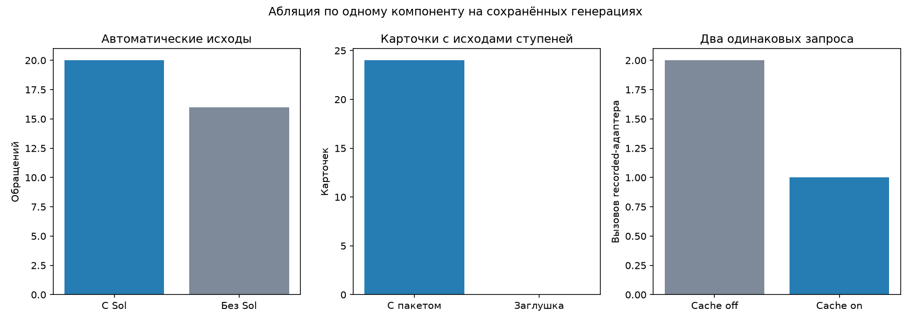

# LAB05: результаты доработки каскада

Обновление 20.11: [сохранение категории и новые живые проверки](lab5-category.md).
Ниже сохранён опыт 19.11 со своим зафиксированным runtime.

Runtime `lab5-ai-engineer-testing-2026-11-19`. Данные, параметры и финансовая история —
в [финальных метриках](../ml-final-metrics.md). [Выполненный ноутбук](lab5.ipynb).

## Гипотеза и метод

Каскад должен восстанавливать пригодный автоматический исход после ошибки
первой ступени, а при нерешённом случае сохранять понятную карточку специалисту.
Проверка состоит из 44 новых живых входов и офлайн-абляции по одному компоненту.
Сначала записаны реальные генерации; затем production queue/engine выполняется
с ними повторно. Полный replay воспроизвёл все 44 результата по полям
mode/category/status/needs_human_review без расхождений.

Это абляция системы при фиксированном первом ответе, не новая генерация
другого промпта. Новых LLM-вызовов в analyze.py и ноутбуке нет.

| Компонент | Полная система | Отключён только он | Измеряемый эффект |
|---|---:|---:|---|
| Sol | 20 автоматических | 16 | Дополнительно 4 автоматических исхода при одинаковых правилах приёмки |
| Handoff | 24 карточки с исходами API | 0 | Оператор получает конкретные основания передачи |
| Cache | 1 cache hit на повторе | 0 cache hits | Один вызов recorded-адаптера вместо двух в опыте с повторным запросом |

Автоматизация и правильность не отождествляются. При одинаковых неизменённых
эталонах, для 38 входов: режим с Sol=28/38 (73.7%),
без Sol=27/38 (71.1%);
категория с Sol=23/38 (60.5%),
без Sol=18/38 (47.4%).
Для 6 регрессий режим с Sol=4/6 (66.7%),
без Sol=3/6 (50.0%).

## Sol: результат по входам

| Вход | Без второй ступени | С Sol |
|---|---|---|
| UC01-02 | escalate / other | escalate / access |
| UC01-07 | escalate / other | answer / settings |
| UC01-08 | escalate / other | answer / product_error |
| UC03-10 | escalate / other | escalate / access |
| UC04-05 | escalate / other | clarify / access |
| REG-e42-2 | escalate / other | clarify / product_error |
| REG-e42-3 | escalate / other | escalate / product_error |

При отключении Sol mandatory-review для product_error не ослабляется: такой
готовый ответ не разрешается автоматически только ради улучшения baseline.
Поэтому comparator означает отсутствие второй ступени в нынешней политике,
а не историческую Mistral15 октября. Сравнение с первым коммитом остаётся в LAB04.

## Ручная карточка и cache

Пакет backend содержит исходное сообщение, атрибутированную переписку,
проверенные источники-кандидаты, исходы обоих API и следующий шаг. Без enrichment
эти сведения не заполнены в самой generic-карточке, хотя input_json в БД
сохраняется в обоих вариантах. Это локальный эффект представления данных,
не новая модельная accuracy и не утверждение, что раньше история исчезала из БД.

Cache проверен на одном валидном ordinary-answer при двух одинаковых входах.
Без cache recorded-адаптер вызван два раза, с cache один; повторная отдача имеет cache_hit.
Трафик реальных повторов неизвестен, массовая экономия не заявляется.

## Выполненные доработки

| Направление | Что изменили | Результат доработки |
|---|---|---|
| Формат уточнений | Ввели тип запрашиваемого факта requested_fact | Проверка использует тип сведений, а текст вопроса модель формулирует свободно |
| Учёт диалога | Добавили состояние известных и недоступных клиенту сведений | При следующем разборе модели получают информацию об уже сообщённом или неизвестном коде ошибки |
| Обоснование ответа | Уточнили системные инструкции и привязку к источникам | В инструкции разделены подтверждённые сведения, диагностические рекомендации и предварительные предположения |
| Контроль product_error | Готовые ответы этой категории направили на независимый разбор Sol | Вторая ступень проверяет исходное обращение и источники перед автоматической приёмкой |
| База знаний | Подготовили версию support-20261119 из 10 статей | Добавили процедуры диагностики, повторной E42, расхождения оплаты и восстановления 2FA |
| Карточка специалиста | Собрали вопрос, историю, источники, этапы и следующий шаг | Для 24 ручных исходов сохранены конкретные результаты обращения к API |
| Работа с провайдерами | Добавили durable-учёт квот, Retry-After и сверку биллинга | Очередь учитывает ограничения Mistral и сохраняет финансовую историю попыток |

Промпты и база знаний проверены в составе итоговой версии на 44 входах.
Вклад Sol, обогащения карточки и cache дополнительно проверен отдельными
абляциями. Изменения промпта и БЗ в этом опыте по отдельности не отключались.

## Измеренное улучшение

При подключении Sol число автоматических исходов выросло с 16 до 20 на
44 входах: с 36,4% до 45,5%, на 9,1 процентного пункта. Число ручных исходов
сократилось с 28 до 24. На 38 обращениях Quality количество совпадений
категории с эталоном выросло с 18 до 23, режима — с 27 до 28.
Совпадение с эталоном и автоматическая приёмка считаются отдельными метриками.

## Последняя миля и решение

В согласованный runtime включены typed requested_fact вместо точного сравнения
названий; недоступный код и последние исправления в диалоге; durable Mistral2RPM
и Retry-After; сверка биллинга без стирания неизвестных списаний; контрольный
разбор готовых product_error через Sol; компактный system и точный контракт
input_quote; новая версия KB; содержательная карточка при отказах.
Проверки tagged-кода: 138/138 SQLite и 138/138 PostgreSQL, отдельно Langfuse,
полный новый eval и replay-абляция. Пороги не ослаблены. Модельные веса не обучались.

Вывод: сохранять каскад по нынешним правилам; сначала получать предусмотренные
процедурой сведения, затем при необходимости передавать содержательную карточку.
Каскад увеличил число автоматических исходов; для обращений, которым требуется
специалист, подготовлена содержательная карточка. Детальные результаты каждого
входа и сопоставление с критериями приёмки приведены в финальных метриках.

[Исходная абляция](../../ml/experiments/lab5/evidence/analysis/ablation.json),
[команды](../../ml/experiments/lab5/README.md), [документация AI](../ml-documentation.md).
