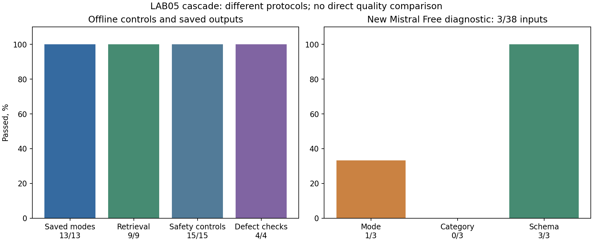

# LAB05: актуальный вердикт Quality после интеграции

Сверка 12.11.2026, D-022. В общую ветку Quality включены её прежний Q-013,
Delivery PR39/41/42/43, AI PR38/40 и памятка Product P-012. История сохранена.
Рабочий код совпадает по 156 фиксированным входам с опубликованным релизом
`lab5-release-delivery-2026-11-12`, SHA `d41349ffd86f749506987bcc398b0a5fa3239917`. Main не слит.

## Что перепроверено

- Полный suite: все семь групп, 144 теста приложения, контракты, EVT SQLite/PG,
  безопасность и cascade replay прошли. Дополнительно 65 каскадных тестов
  выполнены с отдельной PostgreSQL; они пересекаются с общим набором.
- В отдельном чистом checkout точного тега повторён весь suite с PostgreSQL:
  tag_verified=true. Это отдельное свидетельство, не подмена HEAD новой ветки.
- 15/15 контролей каскада, 4/4 регрессии Q5-SEC-001, 16/16 прежних атак,
  сохранённый replay 13/13 и retrieval 9/9. Провайдеры в регрессиях управляемые.
- По D-021 публичный Render действительно работает в cascade: Mistral HTTP200
  дал resolved, таймаут Mistral привёл к Sol HTTP200 и ручному исходу; две
  карточки и review сохранились после restart. Это два smoke-кейса, не full eval.

[Повтор suite](../../tests/evals/evidence/lab5-integrated-20261112/review-summary.json),
[точный тег](../../tests/evals/evidence/lab5-integrated-20261112/release-summary.json),
[состав интеграции](../../tests/evals/evidence/lab5-integrated-20261112/integration.json),
[реальный production smoke](../../tests/evals/evidence/deployment-cascade-providers.json).

## Сверка с четырьмя пунктами роли

| Пункт | Итог проверки |
|---|---|
| Финальный отчёт и динамика | История и графики есть; полный независимый новый baseline каскада ещё не получен |
| Безопасность после исправлений | Контроли и регрессии повторены; смысловые остаточные риски сохранены |
| Регрессия зафиксированного релиза | Полный suite на точном теге прошёл, 156 входов совпали; CI тега зелёный |
| 3–5 фактов и скриншоты | Обновлены trust-facts.md, добавлен настоящий скрин CI и ссылка на снимок Grafana |

Вердикт: техническая регрессия зелёная; доказательств для полной смысловой
приёмки и заявления о достижении North Star недостаточно. Исходный протокол
двух людей остаётся n=0. Результаты частичного free-прогона 3/38 и его ошибки
не переписаны, два новых production smoke не заменяют этот набор. Неделя uptime
не заявляется. Политика автоматического resolved требует отдельного Product review.

## Исторические подробности Q-013

Далее сохранён исходный отчёт Q-013. Утверждения о Sol=0 и отсутствии production
относятся к тому прежнему опыту, до D-019–D-021.

Дата проверки: 12.11.2026. Кандидат: `lab5-release-cascade-2026-11-12`.
Основа: main `597a8f6`, интеграция Delivery PR39 и AI Engineer PR40
(`d2a684b`). Это кандидат в рабочей ветке: слияние и production-деплой не выполнялись.

## Что проверяем

Mistral готовит карточку и assessment. Безопасный полный answer/clarify система
может пометить resolved без operator review. Ошибки, неполнота и эскалации
проверяются Sol; недоступность, лимиты и сохраняющиеся риски ведут к manual_review.
Кэш ограничен доверенной учётной записью, версией данных и политикой.
Автоматическое resolved не означает человеческую проверку и не отправляет сообщение
в helpdesk. Самостоятельно модель не вправе ставить resolved.

## Прогоны и границы показателей

| Проверка | Факт | Что этот результат означает |
| --- | --- | --- |
| Прежний полный golden replay | 49 записей, 38 разных входов; режим 35/38, категория 36/38, схема/gate 38/38, false answer 0/28 | Регрессия старого одноступенчатого baseline, не новый baseline каскада |
| Каскад на сохранённых реальных ответах | Режим 13/13; нужные статьи найдены 9/9; кэш проверен на 7 парах | Прежние генерации повторены на нынешнем коде; известный development-набор |
| Новые контролируемые проверки каскада | 15/15 | Реальные HTTP API, очередь и SQLite с имитаторами провайдеров |
| Исправление Q5-SEC-001 | 4/4 регрессии | Найденный реальный неподтверждённый запрет повторной выдачи кода блокируется |
| Тесты приложения | 140 успешно локально | Включают новую архитектуру, миграции и прежние проверки |
| Прежние отдельные проверки | 6 контрактов, EVT-01–14, 16 управляемых атак | Сохранены отдельно, не заменяют каскадные проверки |

История до каскада: [график за семестр](metrics-history.png). Протоколы и объёмы
различаются; 13/13 нельзя сравнивать как доказанный рост относительно 35/38.

## Новый бесплатный Mistral

Выполнены три отдельные серии: предварительная 1 попытка, быстрый прогон 2 входов,
после исправления и с паузами 60 секунд — 3 входа из 38 запланированных.
Всего 6 попыток бесплатного Mistral, платных вызовов 0. Два раза получен HTTP 429,
одна попытка завершилась по deadline. После 429 серия прекращалась.

В последней серии режим совпал в 1/3, категория в 0/3, итоговая схема валидна 3/3,
ложный answer — 0/1 на входе, где answer не ожидается. Два ручных исхода имеют
резервную category=other из-за deadline/429; в единственном завершённом ответе
о счёте модель дала settings вместо payment. Это диагностика трёх входов,
не устойчивая метрика и не успешный полный прогон. Sol запрещён и денежный резерв
равен нулю: такой опыт не измеряет качество двухпровайдерного каскада целиком.

В первой серии полный ответ не дал ожидаемую категорию. В быстром прогоне выявлен
неподтверждённый answer о коде 2FA (Q5-SEC-001). Ответ сохранён без исправления;
после изменения кода повторена именно эта генерация. Последующий live timeout
не выдаётся за живое подтверждение исправления.

## Сравнение с LAB01

| Критерий | Факт | Вывод |
| --- | --- | --- |
| Полезная карточка / North Star, предложенная цель 85%, минимум 30 | По исходному протоколу двух проверяющих n=0 | Не измерено; имеющиеся отзывы — отдельный вид проверки |
| Валидность результата | Legacy 38/38; новый частичный free-прогон 3/3 | Не доказывает качество на новых обращениях |
| Ложный answer не более 2% | Legacy 0/28; актуальный live-прогон неполон | Недостаточный объём и независимость; гарантия не заявляется |
| p95 и стоимость | Нет полного актуального прогона с обоими провайдерами | Данные прошлой нагрузки не приписываются каскаду |
| Безопасность | Повтор старых 16 и новых 15 проверок, 4 регрессии дефекта | Пройдены перечисленные сценарии; остаются смысловые риски |

## Что проверили люди

Найдены записи участника: 11.11 — 9 «Верно» и 1 «Частично» из 10;
ранняя серия 12.11 — по одному «Верно», «Частично», «Неверно»;
после изменения support policy — 3 «Верно» из 3. Версии и входы пересекаются:
не складываем их в 16 независимых наблюдений и не подменяем ими North Star.
Нет двух независимых оценок фактов/следующего шага/работы без перечитывания истории.
[Аудит происхождения оценок](../../tests/evals/evidence/lab5-cascade/human-review-audit.json).

## Релизная регрессия и вердикт

`tests/evals/lab5.py suite --require-tag lab5-release-cascade-2026-11-12`
сверяет точный HEAD и hashes, выполняет legacy golden, приложение, контракты,
события, безопасность и отдельный cascade_release. CI дополнительно проверяет
PostgreSQL, UI, контейнер с BASELINE_MODE=cascade и настоящий тестовый мониторинг.
Статус текущего тега и исходные логи находятся в GitHub Actions; локальный
предварительный summary с tag_verified=false не выдаётся за прогон на теге.

Вердикт: техническая регрессия проверена в указанном объёме. Смысловая готовность
автоматических ответов для реальных клиентов НЕ подтверждена. Нужны полный
актуальный модельный прогон, Product review политики автоматизации и человеческий
замер по PRD. Ошибки категорий и ограничения free API остаются открытыми.

[Каскадный replay](../../tests/evals/evidence/lab5-cascade/saved-cascade.json),
[контроли](../../tests/evals/evidence/lab5-cascade/cascade-controls.json),
[последний free-прогон](../../tests/evals/evidence/lab5-cascade/live-free-paced/report.json),
[безопасность](final-security-report.md), [факты доверия](trust-facts.md).

## Перепроверка учебного пакета

`python -m pip install -r tests/evals/requirements.lock`

`python tests/evals/run_lab5.py --output <новая папка результатов>`

Пакет автономно пересчитывает сохранённые ответы и регрессию модельной политики
на неизменённом минимальном срезе релизного кода. Полные API/SQL-прогоны исходного
релиза подтверждают приложенные summaries и скрин CI. Исторические команды выше
относятся к DEVELOPMENT. Ключи и новые модельные вызовы этой проверке не нужны.
