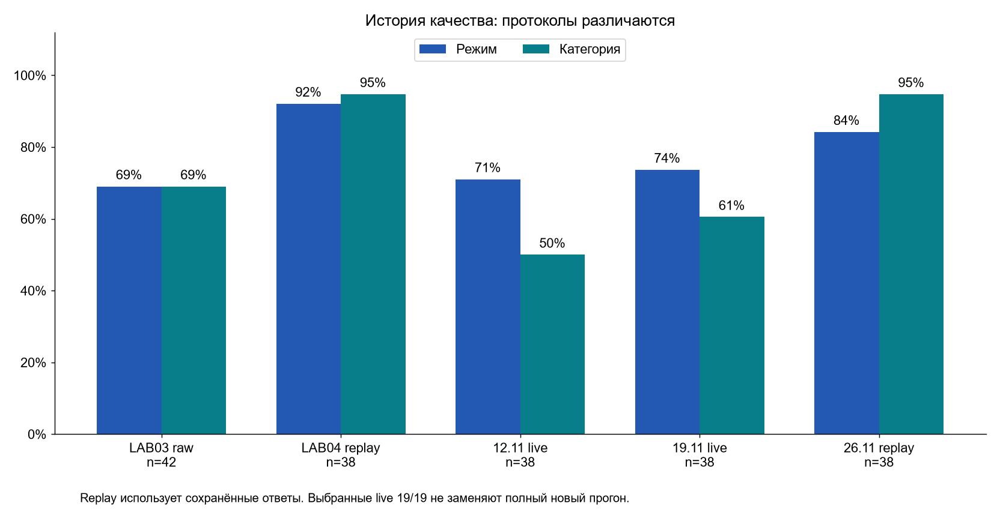

# LAB05: факты доверия после исправлений AI

Перепроверено на теге `lab5-quality-release-2026-11-26-r2`, SHA `49ae0184383571713ce5e6a0a15579ff77d1c8b0`;
код `1a44f7186ef6cb97ed2e5888e9a94bc1a5cae13e`.

1. **Полный replay 38 входов выполнен заново:** режим 32/38, категория 36/38,
   Macro-F1 категории 0,9321, схема и точные цитаты 38/38, ложный answer 0/28.
   Это сохранённые реальные генерации с новым кодом обработки, не новые ответы LLM.
2. **Прирост на тех же генерациях:** режим 28→32 из 38, категория 23→36 из 38.
   Эталоны не переписывали; исправлено сохранение категории и безопасные уточнения.
3. **Отдельная живая серия AI:** 19/19 по режиму и категории. Это выбранные
   проблемные/контрольные входы 20.11, а не новый полный независимый набор.
4. **Технические проверки повторены:** шесть групп, 182 теста приложения,
   15 каскадных контролей, 4 регрессии и 16 управляемых атак. Новых расходов нет.
5. **Границы указаны:** режим 84,2% ниже 90%; North Star n=0. Схема и цитаты
   не доказывают правильность всех смысловых утверждений.

График показывает разные протоколы, а не один причинный эксперимент.
[Числа и исходные ответы](../../tests/evals/evidence/lab5-current-20261126/report.json),
[отчёт качества](final-quality-report.md), [безопасность](final-security-report.md).

Для выступления: «Мы повторили все 38 сохранённых входов на исправленном
приложении. Категория выросла до 36 из 38, режим — до 32 из 38. Отдельно есть
19 новых выбранных ответов, но полного нового live после последней правки нет.
Привязка к тегу подтверждена, целевой гейт режима не прошёл; полезность карточек оператору ещё надо измерить».

Прежние [три слайда](quality-demo.pptx) и скриншот CI относятся к выпуску
12.11; они сохранены как исторические материалы. Для актуальных чисел использовать
этот блок и новый график.
