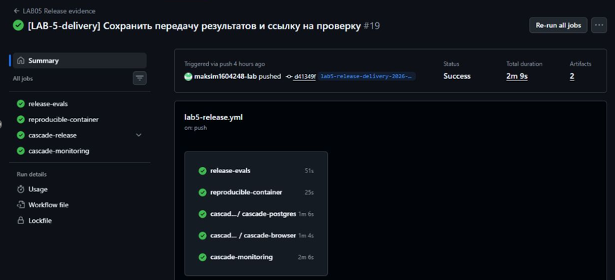
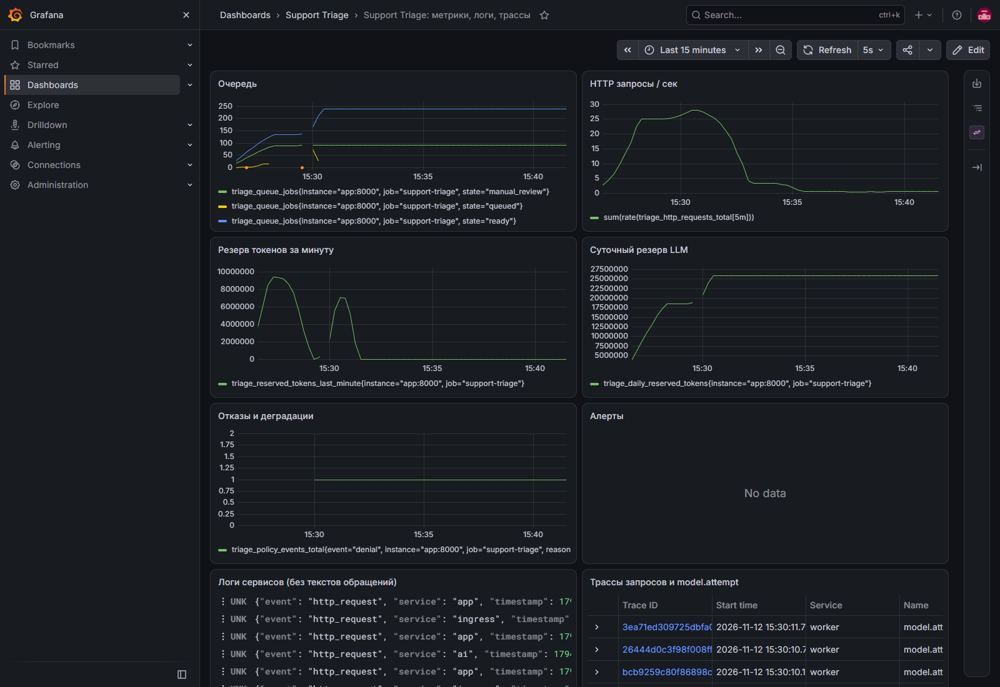

# LAB05: пять проверяемых фактов доверия

12.11.2026, после D-022. Код релиза `lab5-release-delivery-2026-11-12`, d41349f.

1. **144 теста приложения и семь групп suite прошли**. Полный повтор выполнен
   на точном Git-теге с PostgreSQL. Дополнительные 65 каскадных PG-тестов
   пересекаются с общим набором, поэтому их не складываем как независимые.
2. **15/15 каскадных контролей, 4/4 регрессии реального дефекта и 16/16 прежних
   атак** проходят на актуальном коде. Опасные ответы управляемые; это не
   доказательство иммунитета живой модели ко всем инъекциям.
3. **13/13 сохранённых сценариев, retrieval 9/9** повторены на актуальном коде.
   Это знакомый development replay; неполный free-прогон 3/38 с режимом 1/3 и
   категорией 0/3 сохранён и не заменён более удобными числами.
4. **200/200 инфраструктурных UC-сценариев** D-019 прошли при 1–16 клиентах.
   При остановленном worker приняты 100 задач, 101-я получила 503; после
   восстановления обработаны все 100. LLM в этой нагрузке имитируются.
5. **Два настоящих production smoke-кейса** D-021: автоматический ответ Mistral,
   таймаут первой ступени → Sol → ручная проверка. Обе карточки и решение
   оператора сохранились после Render restart. Оба провайдера дали HTTP200;
   это не полный baseline, недельный uptime или сверенный денежный счёт.

Исходный человеческий North Star остаётся n=0; неизвестные данные не заполняются
агентом. Полная независимая смысловая приёмка и неделя наблюдений ещё нужны.

## Настоящие скриншоты для слайдов

Релизный CI: точный d41349f и тег, success. [Открыть запуск](https://github.com/SIISKI/siiski_volchkova_shared_repository/actions/runs/43222614612).

Grafana D-019 после аварийных опытов: локальный Docker, синтетические провайдеры,
11 healthy сервисов, активных алертов нет. Это снимок того измерения, не
непрерывный мониторинг production.

[Свежие повторные проверки](../../tests/evals/evidence/lab5-integrated-20261112/integration.json),
[production свидетельства](../../tests/evals/evidence/deployment-cascade-providers.json),
[нагрузка](../../tests/evals/evidence/lab5-delivery-20261112/load.json), [ограничения](final-quality-report.md).
Историческая [динамика за семестр](metrics-history.png) и
[каскадные виды измерений](cascade-metrics.png) сохранены без изменения чисел.

## Блок для презентации

[Три слайда Quality с заметками докладчика](quality-demo.pptx).

Текст выступления: «В своей роли я проверил техническую регрессию каскада
на зафиксированном релизе. Набор приложения содержит 144 теста. Отдельно повторены
15 проверок защиты и четыре регрессии найденного дефекта. Мы сохранили исходные
ошибочные ответы и проверили исправления. CI, PostgreSQL, интерфейс и тестовый
мониторинг прошли проверки. На рабочем сайте проверены обе модели и сохранность
карточек после перезапуска. Полный новый модельный прогон и человеческий
North Star остаются открытыми, поэтому полную смысловую приёмку я не заявляю».

Это подготовленный рассказ для обсуждения. Нового согласования командой
или человеческой приёмки данным пакетом не заявляем.
